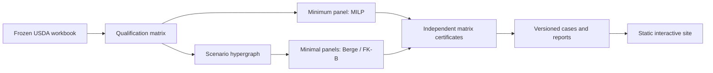

# Resilient Supplier Panels

**If one supplier drops out, can every product in a basket still be bought?** This project
answers that question for food products on the USDA's public list of approved suppliers,
and shows which suppliers to rely on.

[Live site](https://symonyeal.github.io/Resilient-Supplier-Panels/) ·
[Case study](docs/CASE_STUDY.md) ·
[Release 0.2.0](https://github.com/symonyeal/Resilient-Supplier-Panels/releases/tag/v0.2.0)

## The short answer

- **Most baskets have no backup.** In 30 of 40 baskets drawn from the list (3 to 20
  products each), no combination of suppliers survives the loss of any one supplier.
- **The cause is always one product.** Each of those 30 baskets contains a product that only
  one supplier is approved to provide. Choosing suppliers differently cannot fix that.
  Approving a second supplier for that product can.
- **Where backup is possible, it is cheap in suppliers.** In the other 10 baskets, 2 to 6
  suppliers cover every product even if any one of them fails.

## The question

The USDA's Agricultural Marketing Service approves vendors for specific products before they
may bid on its food purchases. The approved vendors and their products appear on the
[Qualified Bidders List](https://www.ams.usda.gov/selling-food/solicitations).

A buyer chooses a *panel*: a set of suppliers that together cover every product in a basket.
A resilient panel still covers every product after any one supplier fails. The questions
are how small a resilient panel can be, how many choices exist, and which suppliers cannot
be replaced.

## Three examples

| Basket | Approved suppliers | Smallest resilient panel | Resilient panels to choose from |
| --- | ---: | ---: | ---: |
| Canned pinto beans, vegetarian beans, tomato sauce | 21 | 2 | 1,284 |
| Three frozen or chilled chicken products | 6 | 2 | 1 |
| Dry lentils, canned pears, fresh sweet potatoes | 4 | none | 0 |

Panels are counted only when no supplier in them is redundant.

- **Canned:** 1,284 options leave room to choose on price, capacity and delivery record.
- **Poultry:** one product has only two approved suppliers, so both are required. A single
  resilient panel means the buyer has no choice.
- **Scarce:** lentils and sweet potatoes each have one approved supplier. No panel is
  resilient until another supplier is approved.

On the [live site](https://symonyeal.github.io/Resilient-Supplier-Panels/) you can pick a
basket and a panel, fail a supplier, and see which products lose coverage. You can download
a one-page report. All [88 measured cases](https://symonyeal.github.io/Resilient-Supplier-Panels/#outcomes)
(44 baskets, each with and without a failure) can be browsed and filtered.

## What this does and does not tell you

**Does:** whether the approvals on paper allow full coverage when a supplier fails, which
suppliers are irreplaceable, and which product is the bottleneck.

**Does not:** capacity, price, delivery record, or whether a supplier will bid. It also does
not show whether two suppliers share a plant or an owner. A listed vendor need not be the
producer, and a billing address is not a plant. The data is one snapshot (retrieved
2026-10-15), not a history. This is research, not a purchasing recommendation.

## How the results are checked

1. **Fixed source.** The USDA workbook is frozen and fingerprinted, so every result names
   the exact data it came from.
2. **Two methods.** An optimisation solver finds the smallest resilient panel; a typical basket
   takes under a millisecond. Enumeration algorithms from the author's MSc thesis list every
   alternative.
3. **Independent check.** Separate code checks every panel directly against the USDA list.
   A second solver checks that no panel was missed.

Benchmark timings are historical (one run, October 2026) and were not rerun for this release.
[Findings](docs/findings/2026-10-15-supplier-resilience.md) ·
[Validation](docs/VALIDATION.md)

## Try it on your own basket

Requires Python 3.14 and Git. From a copy of this repository:

```text
python -m pip install "setuptools>=77" wheel
python -m pip install --no-build-isolation .
srl build --basket examples/canned.csv --k 1 -o basket.json
srl solve basket.json -o solution.json
```

Replace `examples/canned.csv` with your own list of products. `--k 1` means "survive any one
failure". Expected result for the example: a two-supplier panel.

## For technical readers

A panel T is feasible when, for every product p, it keeps a qualified member under every
modelled failure. For any k failures this means |T ∩ E_p| ≥ k + 1. Minimal panels are the
minimal transversals of a scenario hypergraph. MILP gives a minimum-cardinality panel;
Berge and FK-B enumerate. Matrix witnesses certify minimality, and a separately encoded
MILP certifies that no panel is missing. Proofs are in [MODEL](docs/MODEL.md).



Seed-1 suite (code `09cb123`, 10 s limit): median MILP minimum 0.8 ms; Berge completed 84
of 88 enumerations, FK-B and MILP enumeration 76. The 4 unfinished enumerations are
reported as lower bounds. [Protocol](docs/BENCHMARKS.md)

| Responsibility | Code |
| --- | --- |
| Read qualifications and preserve provenance | `srl/qbl.py`, `srl/catalog.py` |
| Failure model and scenario hypergraph | `srl/instance.py` |
| Solve and enumerate | `srl/solve.py` |
| Certify from the matrix | `srl/certify.py` |
| Versioned documents and data selection | `srl/contracts.py`, `srl/resources.py` |
| Public cases and site data | `srl/portfolio.py`, `analysis/build_site.py` |
| Benchmark and report | `srl/bench.py`, `srl/report.py`, `srl/verdicts.py` |

Full reproduction and checks:

```text
python -m pip install --no-build-isolation ".[dev]"
python analysis/build_site.py      # rebuilds site/data.js and site/cases.json after certificates pass
srl enum basket.json --method berge -o family.json
srl verify family.json             # 1,284 certified panels; milp_exhaustion: complete
python -m pytest -q
python -m ruff check .
python analysis/check_browser.py   # needs .[browser]; uses Edge on Windows
```

The site opens from `site/index.html` with no server or network; Plotly basic 4.1.1 (MIT) is
vendored. Supplier IDs are snapshot rows; 31 possible duplicate identities are unresolved.
[Interface](docs/INTERFACE.md) · [Data](docs/DATA.md) · [Decisions](docs/DECISIONS.md) ·
[Open work](docs/OPEN.md) · [Sources](docs/SOURCES.md) · [Glossary](GLOSSARY.md) ·
[Changelog](CHANGELOG.md)

## Licence and attribution

GPL-3.0-or-later; see [LICENSE](LICENSE). Uses the author's
[Hypergraph-Dualization](https://github.com/symonyeal/Hypergraph-Dualization)
(S. Y. Islam, MSc thesis, SFU 2024), pinned at `1bb9de48`. USDA data is presumed public
domain as a U.S. Government work; the workbook states no terms.
[Source register](docs/SOURCES.md)
