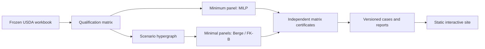

# Supplier Resilience Lab

[Interactive case study](https://symonyeal.github.io/Supplier-Resilience-Lab/) ·
[Technical case study](docs/CASE_STUDY.md) ·
[Release 0.2.0](https://github.com/symonyeal/Supplier-Resilience-Lab/releases/tag/v0.2.0)

Which qualified suppliers cover a food basket, and which panels retain coverage after a
supplier fails? This project connects public USDA qualification data, exact optimization
and independent certificates to an inspectable decision workflow.

**Qualification coverage only.** Capacity, prices, delivery performance and supplier
independence require additional evidence.

## The lead case

Three canned products have 21 eligible suppliers on the frozen USDA Qualified Bidders List.

| Requirement | Minimum suppliers | Inclusion-minimal panels |
| --- | ---: | ---: |
| Current coverage | 1 | 80 |
| Survive any one supplier failure | 2 | 1,284 |

Source: [certified generated cases](site/cases.json), strict mapping, QBL snapshot retrieved
2026-10-15. Every eligible supplier is retained. All panels pass direct matrix certificates;
a separately encoded MILP finds no omitted panel.

The [demo](https://symonyeal.github.io/Supplier-Resilience-Lab/) lets you change the basket,
coverage requirement, panel and hypothetical outage. Inspect lost coverage and alternatives,
search the qualification matrix, and download a decision report or a complete family that
can be reverified locally. All model results are precomputed; the browser runs no solver.
Two further real cases show a forced backup panel and a single-source bottleneck.

## What the experiment found

The original seed-1 campaign covered 88 real-data instances. Single-failure coverage was
feasible for 10 of 40 primary baskets. A single MILP minimum took a median of 0.8 ms;
Berge completed 84 of 88 enumerations, compared with 76 for FK-B and MILP enumeration.

These are historical measurements at code `09cb123`, with a 10 s enumeration limit.
The practical conclusion is to use the MILP and matrix witnesses for the minimum and
bottlenecks, and enumerate when alternatives matter. The current release does not
relabel those timings as a fresh experiment. [Findings](docs/findings/2026-10-15-supplier-resilience.md)
· [Protocol](docs/BENCHMARKS.md) · [Validation](docs/VALIDATION.md)

## Reproduce

Python 3.14 and Git are required. From a clone of this repository:

```text
python -m pip install "setuptools>=77" wheel
python -m pip install --no-build-isolation ".[dev]"
python analysis/build_site.py
```

The last command rebuilds the three cases only after their certificates and independent
exhaustion checks pass. Open `site/index.html`; no server or external JavaScript library
is required. `site/data.js` and `site/cases.json` are generated, committed artifacts.

Use the installed command to reproduce the lead case:

```text
srl build --basket examples/canned.csv --k 1 -o basket.json
srl solve basket.json -o solution.json
srl enum basket.json --method berge -o family.json
srl verify family.json
```

Expected: an optimal two-supplier panel, 1,284 distinct certified minimal panels, and
`milp_exhaustion: complete`. `python -m srl` is equivalent if Python's Scripts directory
is not on PATH. The release wheel includes the frozen data and mappings and works away
from the checkout. [Commands, schemas and data locations](docs/INTERFACE.md)

Verify or build a distribution:

```text
python -m pytest -q
python -m ruff check .
python -m pip check
python -m build --no-isolation
python analysis/check_install.py dist/srl-0.2.0-py3-none-any.whl
```

Optional browser verification: install `.[browser]`, then run
`python analysis/check_browser.py`. It uses installed Edge on Windows; hosted CI installs
Chromium. CI checks Windows and Ubuntu, the installed wheel, and browser interactions.

## How it works



A panel T is feasible when it meets every product's surviving supplier set under every
modelled failure. For any k supplier failures, this is equivalent to having at least
k + 1 qualified panel members for each product. Minimal panels are exactly the minimal
transversals of the scenario hypergraph. The transformation, reductions, boundary cases
and certificates are proved in [MODEL](docs/MODEL.md).

| Responsibility | Code |
| --- | --- |
| Read qualifications and preserve provenance | `srl/qbl.py`, `srl/catalog.py` |
| Build the failure model and scenario hypergraph | `srl/instance.py` |
| Solve and enumerate | `srl/solve.py` |
| Certify directly from the matrix | `srl/certify.py` |
| Exchange versioned documents and select data | `srl/contracts.py`, `srl/resources.py` |
| Build checked public cases | `srl/portfolio.py`, `analysis/build_site.py` |
| Benchmark, report and score pre-registered tests | `srl/bench.py`, `srl/report.py`, `srl/verdicts.py` |

## Scope and continuation

This is one qualification snapshot, with no backtest or disruption probabilities. Supplier
IDs are snapshot row identities; 31 identity candidates remain unresolved. Billing addresses
are not operating sites. Product granularity contains explicit interpretation choices.
The two-supplier stress test does not assert common ownership or a shared facility.

Next research questions include richer operational inputs and symmetry-aware enumeration.
They require separate data and validation. [Open work](docs/OPEN.md) ·
[Decisions](docs/DECISIONS.md) · [Sources](docs/SOURCES.md) ·
[Glossary](GLOSSARY.md) · [Changelog](CHANGELOG.md)

## Licence and attribution

GPL-3.0-or-later; see [LICENSE](LICENSE). The project imports the author's
[Hypergraph-Transversal-Thesis](https://github.com/symonyeal/Hypergraph-Transversal-Thesis)
(S. Y. Islam, MSc thesis, SFU 2024), pinned at
`1bb9de48ab91629a7ae9d97488c2181b4098806d`, also GPL-3.0-or-later.
USDA data is presumed public domain as a U.S. Government work; no terms are stated in
the workbook. [Provenance and source register](docs/SOURCES.md)
