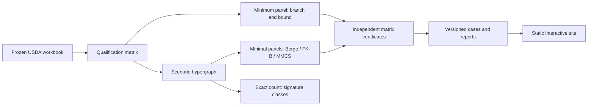

# Resilient Supplier Panels

Results: [live site](https://symonyeal.github.io/Resilient-Supplier-Panels/), [case study](docs/CASE_STUDY.md), [findings](docs/findings/) (including the [release 0.4 analysis](docs/findings/2026-10-25-open-work.md) and the [seed-1 campaign](docs/findings/2026-10-25-rust-campaign.md)). [Releases](https://github.com/symonyeal/Resilient-Supplier-Panels/releases).

## Problem

- The USDA's Agricultural Marketing Service approves vendors for specific products before they may bid on its food purchases. The approved vendors and their products appear on the [Qualified Bidders List](https://www.ams.usda.gov/selling-food/solicitations).
- A *panel* is a set of suppliers that together cover every product in a basket. A panel survives a modelled failure if it still covers every product.
- The project tests whether list suppliers can cover every product in a basket after supplier failures, and identifies the products and suppliers that limit that coverage.
- The analysis finds the smallest resilient panels, counts minimal alternatives, and identifies suppliers that cannot be replaced.

## Model

A panel T is feasible when, for every product p, it keeps a qualified member under every modelled failure. For any k failures this means |T ∩ E_p| ≥ k + 1. Minimal panels are the minimal transversals of a scenario hypergraph. Proofs are in [MODEL](docs/MODEL.md).

## Methods

- Branch and bound gives a minimum-cardinality panel.
- Berge, FK-A, FK-B and MMCS enumerate minimal panels.
- A quotient by supplier signature classes counts panels without listing them.
- Matrix witnesses certify minimality.
- A separately written exhaustive search certifies that no panel is missing.
- Separate code checks every panel against the USDA list.
- The USDA workbook is frozen and fingerprinted; each result names its source.
- Enumeration methods come from the author's MSc thesis and a specialist enumerator.



## Scope and limits

- The model uses qualification records. It does not include capacity, price, delivery record, or whether a supplier will bid. It does not establish shared plants or failure probabilities.
- A listed vendor need not be the producer, and a billing address is not a plant.
- The main campaign uses the snapshot retrieved 2026-10-15; the change analysis compares it with two archived observations.
- Entity scenarios use sourced relationships and explicit joint-outage assumptions. [A common-owner case](docs/COMMON_OWNER_CASE.md) uses a sourced corporate relationship and an explicitly assumed joint outage, and compares approval-only, single-supplier and common-owner protection using the existing model and frozen data.
- Award totals provide context, without unit prices or capacity.
- Basket draws are seeded and are not a demand sample.
- Supplier IDs are snapshot rows. 31 candidate duplicate identities are listed: 6 are supported duplicate-row sensitivities, 13 distinct-row scenarios and 12 stay unresolved. [Remaining evidence requirements](docs/OPEN.md) include comparable price and capacity data.
- Benchmark timings are from one run on one laptop (release 0.3, October 2026). Protocol: [BENCHMARKS](docs/BENCHMARKS.md).

## Execution

Download `srl` for Windows or Linux from the [latest release](https://github.com/symonyeal/Resilient-Supplier-Panels/releases/latest), or build it with [Rust](https://rustup.rs) from a copy of this repository. The frozen USDA data is built into the program.

```text
cargo install --locked --path .
srl build --basket examples/canned.csv --k 1 -o basket.json
srl solve basket.json -o solution.json
```

Replace `examples/canned.csv` with your own list of products. `--k 1` means "survive any one failure". The example returns a two-supplier panel.

Full reproduction and checks:

```text
cargo test --release                 # includes agreement with the thesis code's outputs
cargo run --release -- site          # rebuilds site/data.js and site/cases.json after certificates pass
srl enum basket.json --method berge -o family.json
srl verify family.json               # 1,284 certified panels; exhaustion: complete
srl count basket.json                # the same count from signature classes
python analysis/check_browser.py     # needs playwright; uses Edge on Windows
```

The site opens from `site/index.html` with no server or network; Plotly basic 4.1.1 (MIT) is vendored.

| Responsibility | Code |
| --- | --- |
| Read qualifications and preserve provenance | `src/xlsx.rs`, `src/qbl.rs`, `src/catalog.rs`, `src/audit.rs` |
| Failure model and scenario hypergraph | `src/instance.rs` |
| Minimum and ordered enumeration | `src/solve.rs` |
| Thesis algorithms: Berge, FK-A, FK-B | `src/thesis/` |
| Specialist enumerator and class count | `src/mmcs.rs`, `src/quotient.rs` |
| Certify from the matrix | `src/certify.rs` |
| Versioned documents and data | `src/contracts.rs`, `src/data.rs`, `src/json.rs` |
| Public cases and site data | `src/portfolio.rs` |
| Benchmark and report | `src/bench.rs`, `src/report.rs`, `src/verdicts.rs` |

Documentation: [Validation](docs/VALIDATION.md) · [Interface](docs/INTERFACE.md) · [Data](docs/DATA.md) · [Decisions](docs/DECISIONS.md) · [Open work](docs/OPEN.md) · [Sources](docs/SOURCES.md) · [Glossary](GLOSSARY.md) · [Changelog](CHANGELOG.md)

## Licence and attribution

GPL-3.0-or-later; see [LICENSE](LICENSE). The Berge, FK-A and FK-B code ports the author's [Hypergraph-Dualization](https://github.com/symonyeal/Hypergraph-Dualization) (S. Y. Islam, MSc thesis, SFU 2024) at `1bb9de48`, and is tested against its outputs. USDA data is presumed public domain as a U.S. Government work; the workbook states no terms. [Source register](docs/SOURCES.md)
