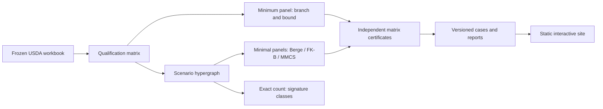

# Resilient Supplier Panels

**If one supplier drops out, can every product in a basket still be bought?** This project
answers that question for food products on the USDA's public list of approved suppliers,
and shows which suppliers to rely on.

[Live site](https://symonyeal.github.io/Resilient-Supplier-Panels/) ·
[Case study](docs/CASE_STUDY.md) ·
[Releases](https://github.com/symonyeal/Resilient-Supplier-Panels/releases)

## The short answer

- **Most baskets have no backup.** In 30 of 40 baskets drawn from the list (3 to 20
  products each), no combination of suppliers survives the loss of any one supplier.
- **The cause is always one product.** Each of those 30 baskets contains a product that only
  one supplier is approved to provide. Choosing suppliers differently cannot fix that.
  Approving a second supplier for that product can.
- **Where backup is possible, it is cheap in suppliers.** In the other 10 baskets, 2 to 6
  suppliers cover every product even if any one of them fails.

## The question

Release 0.4 adds [three dated observations, ranked qualification gaps, entity scenarios
and whole-class baskets](docs/findings/2026-10-25-open-work.md). Across 40,000 seeded
draws, 11,256 have one-supplier backup. Counts reach 75,180,897,792 minimal panels on a
whole-class basket. The original 40-basket headline above remains the October seed-1
campaign. [Remaining evidence requirements](docs/OPEN.md) include 12 unresolved identity
pairs and comparable price/capacity data.

The USDA's Agricultural Marketing Service approves vendors for specific products before they
may bid on its food purchases. The approved vendors and their products appear on the
[Qualified Bidders List](https://www.ams.usda.gov/selling-food/solicitations).

A buyer chooses a *panel*: a set of suppliers that together cover every product in a basket.
A resilient panel still covers every product after any one supplier fails. The questions
are how small a resilient panel can be, how many choices exist, and which suppliers cannot
be replaced.

## Three examples

| Basket | Approved suppliers | Smallest resilient panel | Resilient panels to choose from |
| --- | ---: | ---: | ---: |
| Canned pinto beans, vegetarian beans, tomato sauce | 21 | 2 | 1,284 |
| Three frozen or chilled chicken products | 6 | 2 | 1 |
| Dry lentils, canned pears, fresh sweet potatoes | 4 | none | 0 |

Panels are counted only when no supplier in them is redundant.

- **Canned:** 1,284 options leave room to choose on price, capacity and delivery record.
- **Poultry:** one product has only two approved suppliers, so both are required. A single
  resilient panel means the buyer has no choice.
- **Scarce:** lentils and sweet potatoes each have one approved supplier. No panel is
  resilient until another supplier is approved.

On the [live site](https://symonyeal.github.io/Resilient-Supplier-Panels/) you can pick a
basket and a panel, fail a supplier, and see which products lose coverage. You can download
a one-page report. All [88 measured cases](https://symonyeal.github.io/Resilient-Supplier-Panels/#outcomes)
(44 baskets, each with and without a failure) can be browsed and filtered, each with an
exact count of its panels.

## What this does and does not tell you

[A common-owner case](docs/COMMON_OWNER_CASE.md) uses a sourced corporate relationship
and an explicitly assumed joint outage. It compares approval-only, single-supplier
and common-owner protection using the existing model and frozen data.

**Does:** whether the approvals on paper allow full coverage when a supplier fails, which
suppliers are irreplaceable, and which product is the bottleneck.

**Does not:** capacity, price, delivery record, or whether a supplier will bid. It also does
not establish shared plants or failure probabilities. A listed vendor need not be the
producer, and a billing address is not a plant. The main campaign uses the snapshot
retrieved 2026-10-15; the separate change analysis compares it with two archived
observations. Entity scenarios use sourced relationships and explicit joint-outage
assumptions. Award totals provide context, without unit prices or capacity. This is
research, not a purchasing recommendation.

## How the results are checked

1. **Fixed source.** The USDA workbook is frozen and fingerprinted, so every result names
   the exact data it came from.
2. **Several methods.** An exact search finds the smallest resilient panel in microseconds.
   Enumeration algorithms from the author's MSc thesis, and a specialist enumerator, list
   every alternative; a counting theorem gives the number of panels without listing them.
3. **Independent check.** Separate code checks every panel directly against the USDA list,
   and a separate exhaustive search checks that no panel was missed.

Benchmark timings are from one run on one laptop (release 0.3, October 2026).
[Findings](docs/findings/2026-10-25-rust-campaign.md) ·
[Validation](docs/VALIDATION.md)

## Try it on your own basket

Download `srl` for Windows or Linux from the
[latest release](https://github.com/symonyeal/Resilient-Supplier-Panels/releases/latest),
or build it with [Rust](https://rustup.rs) from a copy of this repository:

```text
cargo install --locked --path .
srl build --basket examples/canned.csv --k 1 -o basket.json
srl solve basket.json -o solution.json
```

Replace `examples/canned.csv` with your own list of products. `--k 1` means "survive any one
failure". Expected result for the example: a two-supplier panel. The frozen USDA data is
built into the program.

## For technical readers

A panel T is feasible when, for every product p, it keeps a qualified member under every
modelled failure. For any k failures this means |T ∩ E_p| ≥ k + 1. Minimal panels are the
minimal transversals of a scenario hypergraph. Branch and bound gives a minimum-cardinality
panel; Berge, FK-B and MMCS enumerate; a quotient by supplier signature classes counts.
Matrix witnesses certify minimality, and a separately written exhaustive search certifies
that no panel is missing. Proofs are in [MODEL](docs/MODEL.md).



Seed-1 suite, release 0.3 (code `55e8e4a`, 10 s limit): Berge finished all 88
enumerations, the slowest in 12 ms, so every family has an exact count (largest 20,478
panels); the class count agrees on all 88. The median minimum took 2 µs. The 0.2 Python
release had left four families censored at 10 s. [Protocol](docs/BENCHMARKS.md)

| Responsibility | Code |
| --- | --- |
| Read qualifications and preserve provenance | `src/xlsx.rs`, `src/qbl.rs`, `src/catalog.rs`, `src/audit.rs` |
| Failure model and scenario hypergraph | `src/instance.rs` |
| Minimum and ordered enumeration | `src/solve.rs` |
| Thesis algorithms: Berge, FK-A, FK-B | `src/thesis/` |
| Specialist enumerator and class count | `src/mmcs.rs`, `src/quotient.rs` |
| Certify from the matrix | `src/certify.rs` |
| Versioned documents and data | `src/contracts.rs`, `src/data.rs`, `src/json.rs` |
| Public cases and site data | `src/portfolio.rs` |
| Benchmark and report | `src/bench.rs`, `src/report.rs`, `src/verdicts.rs` |

Full reproduction and checks:

```text
cargo test --release                 # includes agreement with the thesis code's outputs
cargo run --release -- site          # rebuilds site/data.js and site/cases.json after certificates pass
srl enum basket.json --method berge -o family.json
srl verify family.json               # 1,284 certified panels; exhaustion: complete
srl count basket.json                # the same count from signature classes
python analysis/check_browser.py     # needs playwright; uses Edge on Windows
```

The site opens from `site/index.html` with no server or network; Plotly basic 4.1.1 (MIT) is
vendored. Supplier IDs are snapshot rows; 31 possible duplicate identities are unresolved.
[Interface](docs/INTERFACE.md) · [Data](docs/DATA.md) · [Decisions](docs/DECISIONS.md) ·
[Open work](docs/OPEN.md) · [Sources](docs/SOURCES.md) · [Glossary](GLOSSARY.md) ·
[Changelog](CHANGELOG.md)

## Licence and attribution

GPL-3.0-or-later; see [LICENSE](LICENSE). The Berge, FK-A and FK-B code ports the author's
[Hypergraph-Dualization](https://github.com/symonyeal/Hypergraph-Dualization)
(S. Y. Islam, MSc thesis, SFU 2024) at `1bb9de48`, and is tested against its outputs.
USDA data is presumed public domain as a U.S. Government work; the workbook states no
terms. [Source register](docs/SOURCES.md)
